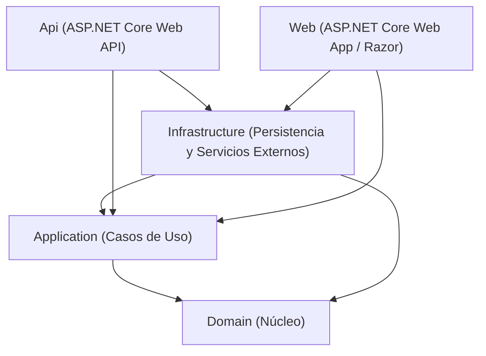

# PerformanceTest

Solución web con arquitectura desacoplada basada en Clean Architecture / Arquitectura en Capas en .NET 10.

---

## 🏛️ Arquitectura y Flujo de Dependencias

El sistema sigue la regla de dependencias unidireccionales de Clean Architecture, donde el dominio empresarial se mantiene aislado de frameworks externos y detalles de infraestructura:



---

## 📁 Estructura del Proyecto

```plaintext
PerformanceTest/
│
├── PerformanceTest.slnx              # Solución principal (.NET 10)
├── README.md                         # Documentación de la solución
│
└── src/
    ├── Domain/                       # Capa de Dominio (Modelos de negocio, entidades)
    │   ├── Domain.csproj
    │   └── Program.cs                # Punto de entrada / arranque del módulo
    │
    ├── Application/                  # Capa de Aplicación (Casos de uso, interfaces, DTOs)
    │   ├── Application.csproj
    │   └── Program.cs                # Punto de entrada / arranque del módulo
    │
    ├── Infrastructure/               # Capa de Infraestructura (Implementación de datos, repositorios)
    │   ├── Infrastructure.csproj
    │   └── Program.cs                # Punto de entrada / arranque del módulo
    │
    ├── Api/                          # Capa de API Web (Endpoints REST / OpenAPI / Minimal APIs)
    │   ├── Api.csproj
    │   ├── Api.http
    │   ├── appsettings.json
    │   ├── appsettings.Development.json
    │   └── Program.cs                # Configuración de pipeline HTTP y servicios API
    │
    └── Web/                          # Capa Web de Presentación (Interfaz de usuario Razor Pages)
        ├── Web.csproj
        ├── appsettings.json
        ├── appsettings.Development.json
        ├── Pages/                    # Páginas y vistas Razor
        ├── wwwroot/                  # Archivos estáticos (CSS, JS, librerías)
        └── Program.cs                # Configuración de pipeline Web y vistas Razor
```

---

## 📦 Descripción de Proyectos

| Proyecto | Tipo | Responsabilidad | Dependencias de Proyectos |
| :--- | :--- | :--- | :--- |
| **`Domain`** | Consola / Biblioteca | Contiene entidades, objetos de valor y reglas de negocio puras. No depende de ningún otro proyecto. | *Ninguna* |
| **`Application`** | Consola / Biblioteca | Contiene la lógica de aplicación, orquestación de casos de uso y contratos/interfaces. | `Domain` |
| **`Infrastructure`** | Consola / Biblioteca | Implementa contratos de persistencia, acceso a base de datos y clientes externos. | `Application`, `Domain` |
| **`Api`** | ASP.NET Core Web API | Expone endpoints REST y servicios para clientes HTTP y frontend. | `Application`, `Infrastructure` |
| **`Web`** | ASP.NET Core Web App | Aplicación web interactiva basada en Razor Pages para usuarios finales. | `Application`, `Infrastructure` |

---

## 🚀 Guía de Ejecución del Proyecto

### 1. Requisitos Previos
- **.NET SDK**: 10.0 o superior instalado en el equipo.
  Verifica tu versión ejecutando:
  ```bash
  dotnet --version
  ```

---

### 2. Restaurar y Compilar la Solución
Desde la raíz de la solución (`PerformanceTest/`), restaura los paquetes y compila todos los proyectos:
```bash
# Restaurar dependencias
dotnet restore

# Compilar todos los proyectos
dotnet build
```

---

### 3. Cómo Ejecutar las Aplicaciones

#### Opción A: Ejecutar la API (`src/Api`)
Abre una terminal en la raíz de la solución y ejecuta:
```bash
dotnet run --project src/Api
```
- **URL Base HTTP**: [http://localhost:5084](http://localhost:5084)
- **URL Base HTTPS**: [https://localhost:7107](https://localhost:7107)
- **Endpoint de prueba**: `GET` [http://localhost:5084/weatherforecast](http://localhost:5084/weatherforecast)
- **Especificación OpenAPI**: [http://localhost:5084/openapi/v1.json](http://localhost:5084/openapi/v1.json)

---

#### Opción B: Ejecutar la Aplicación Web (`src/Web`)
Abre una terminal en la raíz de la solución y ejecuta:
```bash
dotnet run --project src/Web
```
- **URL Base HTTP**: [http://localhost:5007](http://localhost:5007)
- **URL Base HTTPS**: [https://localhost:7102](https://localhost:7102)

*(El navegador se abrirá automáticamente en la página principal).*

---

#### Opción C: Ejecutar API y Web simultáneamente (Entorno Completo)
Para probar la solución completa, ejecuta la API y la Web en dos terminales separadas:

1. **Terminal 1 (Backend - API):**
   ```bash
   dotnet run --project src/Api
   ```
2. **Terminal 2 (Frontend - Web):**
   ```bash
   dotnet run --project src/Web
   ```

---

### 4. Modo Desarrollo con Recarga en Vivo (Hot Reload)
Para que los cambios de código se apliquen automáticamente sin reiniciar el servidor:

```bash
# Para la API
dotnet watch --project src/Api

# Para la Web
dotnet watch --project src/Web
```

---

### 5. Ejecutar Módulos Individuales / Diagnóstico
Cada capa cuenta con su propio punto de entrada para comprobaciones individuales:

```bash
# Módulo de Dominio
dotnet run --project src/Domain

# Módulo de Aplicación
dotnet run --project src/Application

# Módulo de Infraestructura
dotnet run --project src/Infrastructure
```

---

### 6. Ejecución desde IDEs

#### Visual Studio 2022 (v17.10 o superior)
1. Abre el archivo de solución `PerformanceTest.slnx`.
2. Para ejecutar ambos proyectos (`Api` y `Web`) a la vez:
   - Haz clic derecho sobre la solución en el Explorador de soluciones ➜ **Configurar proyectos de inicio...**
   - Selecciona **Proyectos de inicio múltiples**.
   - Configura la acción **Iniciar** para `Api` y `Web`.
   - Presiona `F5` o `Ctrl + F5`.

#### Visual Studio Code / Cursor / Windsurf
1. Abre la carpeta raíz `PerformanceTest`.
2. Abre la terminal integrada (`Ctrl + ~`) y usa los comandos de CLI descritos arriba (`dotnet run --project ...`).
